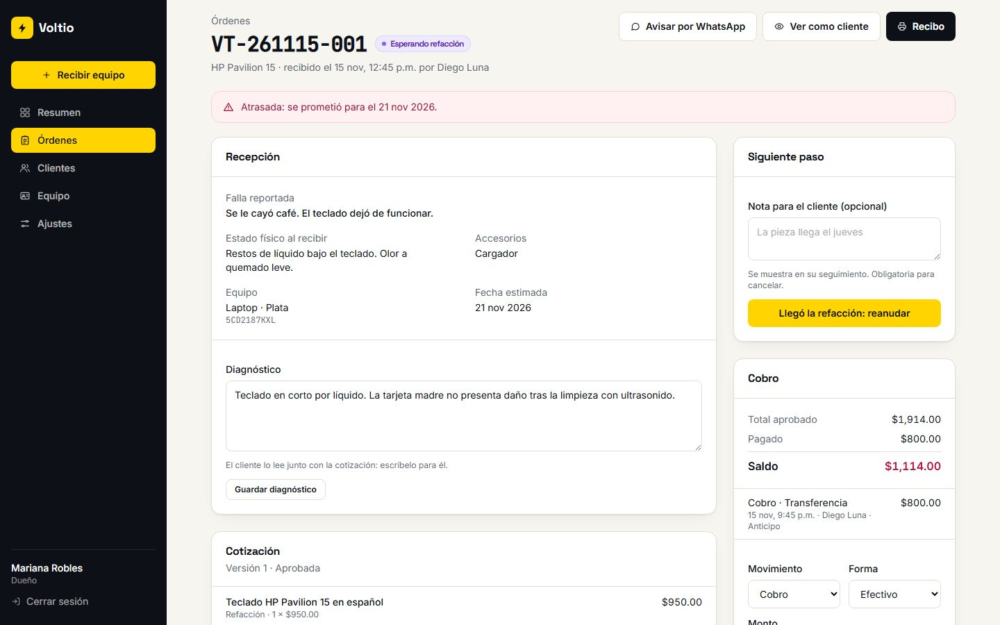
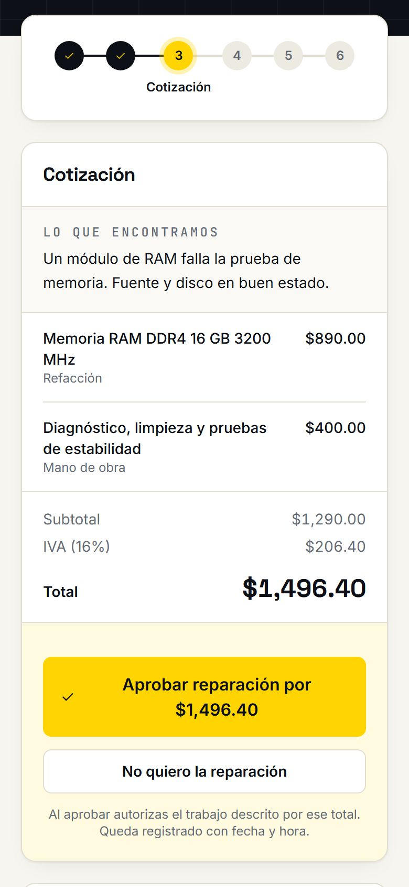
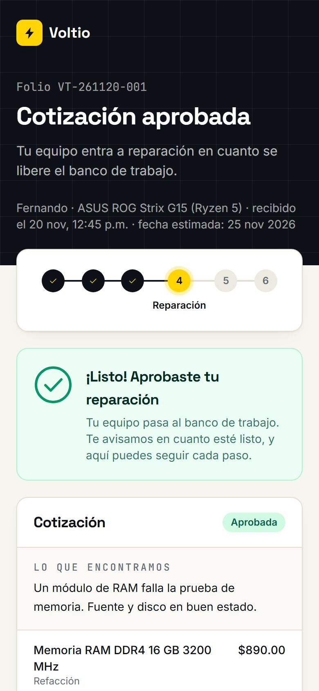
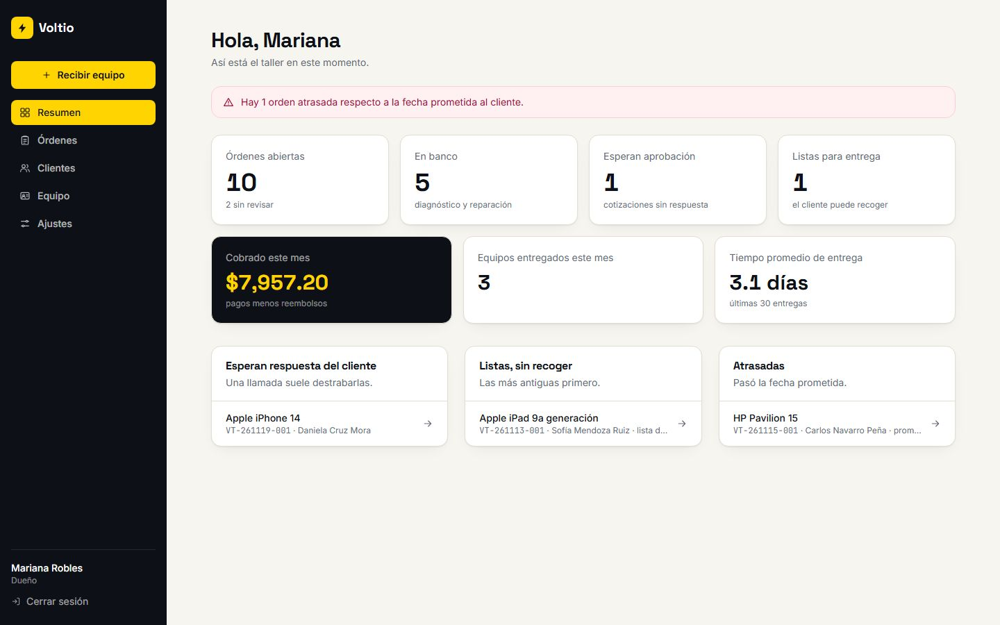
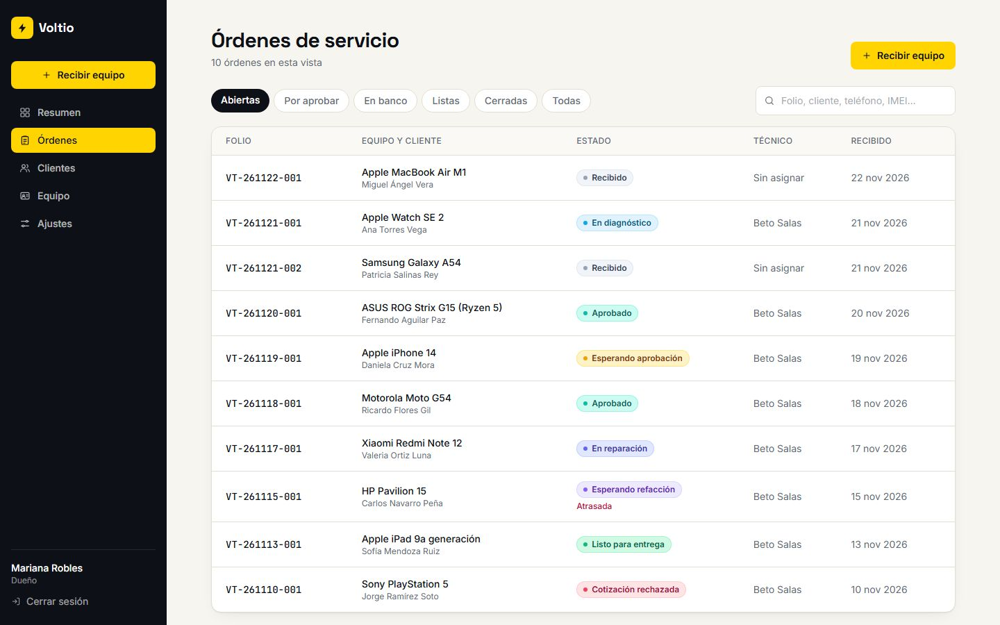
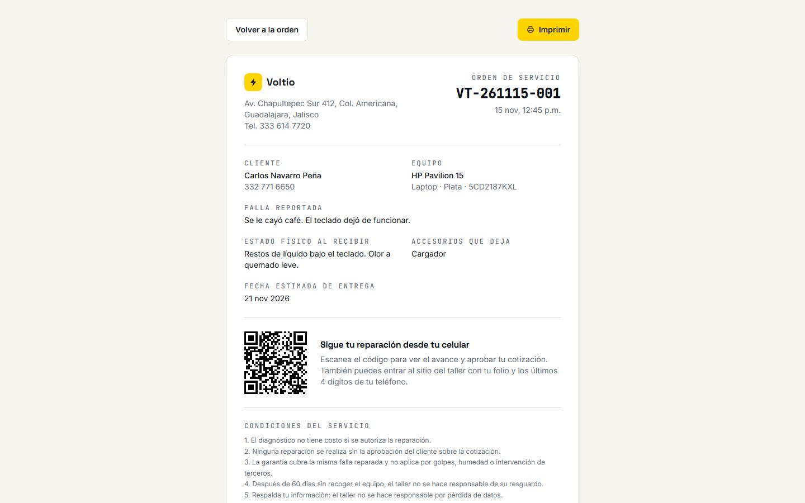
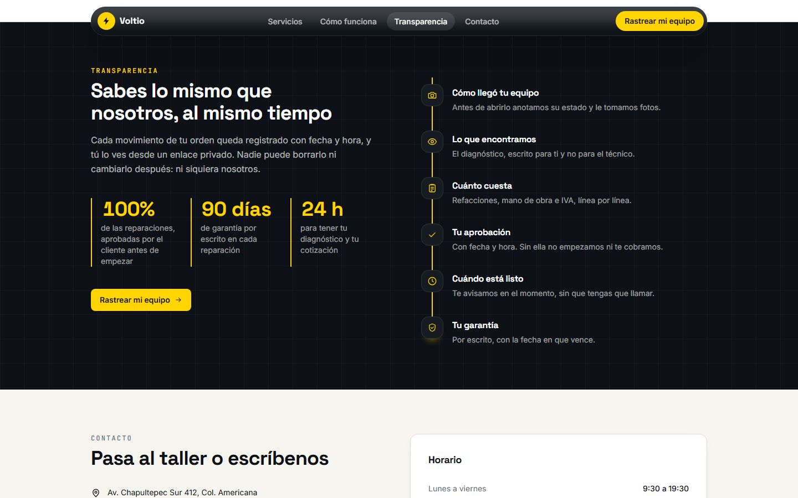
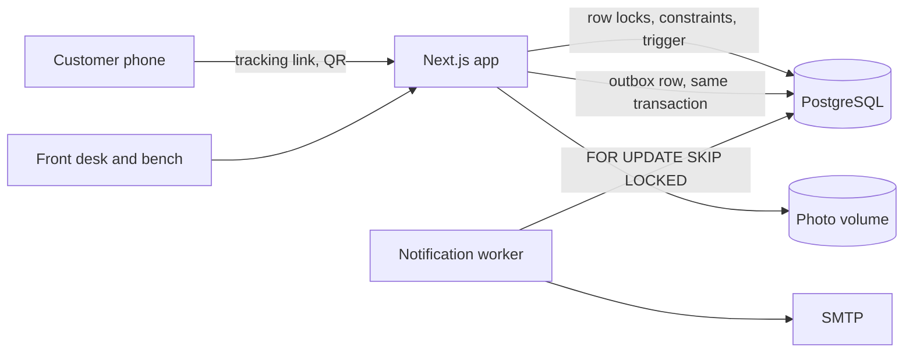

# Voltio — repair shop management system

A complete system to run a repair shop (phones, laptops, consoles): intake with
a folio and a printed receipt, a tracking page the customer opens from a QR
code, quotes the customer approves or declines from their phone, payments at
the counter, warranties, and email notifications on every change.

It is shown here through **Voltio**, a fictional electronics repair shop built
as the sample client. Each real client gets its own deployment, with its own
name, hours, services and terms set from the panel.

Built by [Filiberto Sañudo](https://github.com/filibertosanudo) as a portfolio
piece: the second system of a series by line of business, after
[Sobremesa](https://github.com/filibertosanudo/marea-restaurant), for
restaurants, shown through its sample client Marea.

> **En español:** ver el [resumen al final](#resumen-en-español).

<p align="center">
  
  
  
  
  
</p>

<details>
<summary>More screens</summary>
<p align="center">
  
  
  
</p>

The demo data is fourteen orders in every state of a repair (`prisma/seed.ts`),
built by calling the same functions the panel uses.
</details>

## The problem

A small repair shop runs on paper tickets and phone calls. Three things go
wrong, every week:

- **"Is it ready yet?"** The customer has no way to know, so they call. The
  person who answers has to find the device and ask the technician.
- **"I never agreed to that price."** The quote was given by phone or in
  person. When the bill comes, there is no record of what was approved.
- **"It already had that scratch."** Nobody wrote down the state the device
  arrived in, and there is no history when it comes back a month later.

Voltio answers each one with a record the customer can see: a tracking link,
a quote they approve themselves, and an order history that cannot be edited.

## What it does

**For customers**
- A tracking page behind a private link (the QR code on the receipt): the
  current step, the diagnosis, photos, the full history. No account.
- The quote, line by line with tax, and two buttons: approve or decline.
  Nothing is repaired, and nothing is owed, without an approval.
- Lost the link? The folio plus the last four digits of their phone finds it.
- An email at each step: received, quote ready, waiting for a part, ready for
  pickup, delivered with the warranty date.

**For the front desk**
- Intake in one form: customer (found by phone), device (found by serial),
  reported fault, condition on arrival, accessories. A folio like
  `VT-261115-007` and a printable receipt with the QR code.
- Payments and refunds in cash, card or transfer, against the approved total.
  A device cannot be handed over with a balance pending.
- A WhatsApp button that opens a prefilled message with the tracking link, for
  customers with no email on file.

**For technicians**
- A diagnosis the customer reads, a quote builder with live totals, and the
  moves of the bench: diagnosing, in repair, waiting for a part, ready.
- Extra damage found mid-repair? A new quote goes out and replaces the old one.

**For the owner**
- A dashboard: what is open, what waits for a customer's answer, what is late,
  what was collected this month, average turnaround.
- Staff accounts with three roles, service list, hours, tax rate, warranty
  days and receipt terms, all editable from the panel.
- A returning device inside its warranty is flagged at intake.

## Engineering highlights

The parts most worth a reviewer's time, each with the file that explains it.

- **An approval is a yes to one specific price.** The customer's decision
  carries the id of the quote they were looking at, and the update only
  matches while that quote is still pending. A double tap counts once; a quote
  withdrawn and corrected gets a new id, so a customer with the old page open
  cannot approve a price they have not seen. Partial unique indexes make "two
  live quotes for one order" unrepresentable.
  `lib/quotes/quote-service.ts`, `prisma/migrations/*_add_integrity_rules`.
- **A state machine in one table, enforced after a row lock.** Every move of
  an order is a row of `TRANSITIONS`, with who may make it and whether it is a
  manual move or the consequence of a quote. The rule is read after
  `SELECT ... FOR UPDATE`, so two people pressing conflicting buttons get one
  move and one refusal. `lib/orders/status.ts`, `lib/orders/transition.ts`.
- **A history that cannot be rewritten.** `OrderEvent` is append-only by a
  Postgres trigger that binds every role, the table owner included. Who
  approved what, when, through which channel and from which address stays
  what it was. `prisma/migrations/*_add_integrity_rules`.
- **Notifications that cannot be lost or doubled by a crash.** An email is a
  row written in the same transaction as the change it announces
  (transactional outbox). The worker claims rows with
  `FOR UPDATE SKIP LOCKED` under a lease, retries with backoff, and two
  workers never take the same row. `lib/notifications/`, `scripts/worker.ts`.
- **Every Server Action checks the caller first, by construction.** A test
  parses every `"use server"` file in the repository with the TypeScript
  compiler, not a hand-written list, and fails if an action's first statement
  is not the role check (or, for the two public files, the rate limit).
  `lib/auth/guard-coverage.test.ts`.
- **Money as integer cents, folios from an atomic counter.** Tax is computed
  once on the subtotal in integer arithmetic; two payments entered at once
  cannot together exceed the balance; twelve simultaneous intakes get twelve
  consecutive folios. `lib/quotes/totals.ts`, `lib/payments/`, `lib/orders/folio.ts`.
- **A public page that is built field by field.** The tracking page's data is
  assembled explicitly, and a test serializes it and checks that internal
  notes, the phone number, the email and staff ids are not in it. Uploaded
  photos are typed by their own bytes, never by what the browser claimed.
  `lib/track/public-order.ts`, `lib/photos/validate.ts`.
- **Motion that explains the product, with no library.** The landing's hero
  is a phone playing one repair from diagnosis to pickup, including the tap
  that approves the quote; the tracking page draws the customer's progress
  and marks the moment they approve. It is CSS (scroll-driven timelines, SVG
  stroke drawing) except the stat counters, which write their text per frame
  because Chrome does not repaint an animated CSS `counter()`. Every element
  is complete with motion off, reduced-motion is honored, and loops can be
  paused. `app/motion.css`.
- **Hardened by default.** A nonce-based Content-Security-Policy with no
  third-party origin, argon2id passwords, sessions revalidated every minute so
  a deactivated account is out within one, rate limits kept in Postgres, and
  the client address read from the right end of `x-forwarded-for`.
  `proxy.ts`, `auth.ts`, `lib/security/`.

## Tests

110 tests in 9 files (`npm test`), run on every pull request:

- **Integration tests against a real Postgres**: each file migrates its own
  schema. Races are run as real concurrent transactions: simultaneous
  intakes, a double-tapped approval, approve racing reject, two terminals
  collecting the same balance, two workers on one queue, two owners
  deactivating each other.
- **Unit tests** for the state machine (every open status can reach
  `DELIVERED`; work never starts without an approval), money, dates in the
  shop's timezone, templates and the guard coverage walk.
- Coverage thresholds on the order, quote and payment code fail the build.

There is no browser end-to-end suite yet; see [Status](#status).

## Stack

Next.js 16 (App Router, Server Actions) · React 19 · TypeScript · Tailwind CSS ·
PostgreSQL 17 · Prisma 7 · Auth.js v5 · Vitest · Docker Compose



## Run it locally

With Docker, nothing else to install:

```bash
cp .env.example .env          # set POSTGRES_PASSWORD and AUTH_SECRET; DEMO_MODE=1 for one-click sign-in
docker compose up -d --build
docker compose run --rm seed
```

Then open [http://localhost:3100](http://localhost:3100). The panel is at
`/admin/login`, and every email the system sends lands in the MailHog inbox at
[http://localhost:8026](http://localhost:8026).

<details>
<summary>Seeded accounts (local only)</summary>

| Email | Password | Role |
|---|---|---|
| `duena@voltio.test` | `VoltioDuena123!` | Owner |
| `recepcion@voltio.test` | `VoltioRecepcion123!` | Front desk |
| `tecnico@voltio.test` | `VoltioTecnico123!` | Technician |

These passwords are public: the seed refuses to run against a database that
does not look local unless told to.
</details>

Without Docker: Node 22+ and Postgres 17+, then `npm install`,
`npm run db:deploy`, `npm run db:seed` and `npm run dev`. `npm test` needs a
database in `DATABASE_URL`.

For a real shop, skip the seed and create the first account with
`npm run owner:create -- "Name" email@example.com`.

## Documentation

| | |
|---|---|
| [`docs/DATABASE.md`](docs/DATABASE.md) | Why the schema looks the way it does (Spanish) |
| [`docs/DEPLOY.md`](docs/DEPLOY.md) | Deploying for a client, the reverse proxy, real email |
| [`AGENTS.md`](AGENTS.md) | The rules that are not obvious from the code |
| [`docs/CONVENCIONES.md`](docs/CONVENCIONES.md) | Git, commits, pull requests and comments (Spanish) |

## Status

The scope of a repair shop's daily work is complete. Not built: a browser
end-to-end suite (Playwright), an English interface (the panel and the public
pages are in Spanish, the shop's language), WhatsApp notifications through an
API (today it is a prefilled link the staff sends), card payments online, and
live updates over server-sent events (the tracking page refreshes itself every
30 seconds instead).

---

## Resumen en español

**Voltio** es un sistema completo para operar un taller de reparación
(celulares, laptops, consolas): recepción con folio y recibo impreso, página
de seguimiento que el cliente abre desde un código QR, cotizaciones que el
cliente aprueba o rechaza desde su celular, cobros en mostrador, garantías y
avisos por correo en cada cambio.

Resuelve tres problemas de todos los días en un taller pequeño: el cliente
que llama a preguntar si ya está su equipo, la discusión por un precio que
"nadie aprobó", y la falta de registro de cómo llegó el equipo.

Lo que vale la pena revisar del código:

- **Aprobar es decir sí a un precio específico.** La respuesta del cliente
  lleva el id de la cotización que estaba viendo; si el taller la cambió, se
  rechaza. Un doble toque cuenta una sola vez.
- **Una máquina de estados en una sola tabla**, validada después de bloquear
  la fila: dos personas con botones contradictorios obtienen un movimiento y
  un rechazo.
- **Un historial que no se puede reescribir**, por un trigger de Postgres que
  obliga también al dueño de la tabla.
- **Avisos que no se pierden ni se duplican**: cada correo se encola en la
  misma transacción que el cambio que anuncia, y el worker reparte las filas
  con `FOR UPDATE SKIP LOCKED`.
- **Una prueba que recorre todas las acciones del servidor** y falla si
  alguna no verifica primero quién la llama.
- **110 pruebas**, con integración contra un Postgres real y carreras
  ejecutadas como transacciones concurrentes de verdad.

Hecho por [Filiberto Sañudo](https://github.com/filibertosanudo).
