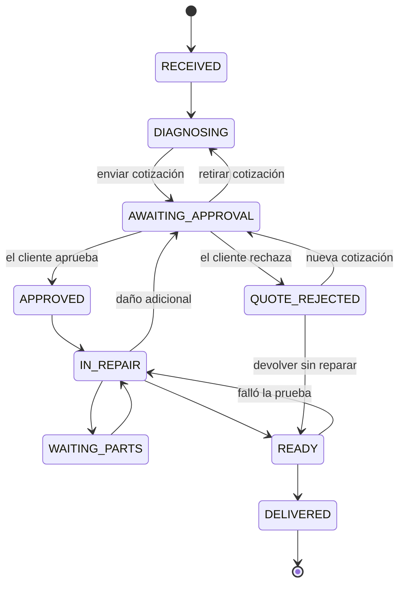

# Voltio — la base de datos y por qué es así

Documento de trabajo. El esquema está en `prisma/schema.prisma`; las reglas que
Prisma no puede expresar, en `prisma/migrations/*_add_integrity_rules`.

## Principio

La aplicación valida para dar un buen mensaje. La base de datos valida para
que el dato incorrecto no pueda existir, lo escriba quien lo escriba: una
acción del servidor, un script, alguien con `psql` a las once de la noche.
Cada regla de abajo existe en los dos lados cuando equivocarse cuesta dinero
o la confianza de un cliente.

## Decisiones

| Decisión | Alternativa descartada | Por qué |
|---|---|---|
| Un taller por instalación; `Business` es una sola fila (`CHECK id = 'main'`) | `businessId` en cada tabla y Row Level Security, como en Marea | Un taller pequeño no comparte servidor con otro. El aislamiento entre negocios es el trabajo más caro de Marea y aquí no compra nada. Si algún día hace falta, es una migración conocida |
| Dinero en centavos enteros (`Int`) | `Decimal(10,2)` | Sin conversión en la frontera servidor/cliente y sin `Prisma.Decimal` que cuidar. El tope de una cotización (10 millones) queda muy por debajo del máximo de `Int` |
| Totales de la cotización guardados, no calculados al leer | Sumar las líneas cada vez | Lo que el cliente aprobó es lo que se cobra, aunque después cambie la tasa de impuesto. `CHECK total = subtotal + impuesto` |
| `OrderEvent` sólo admite inserciones (trigger) | Confiar en que el código nunca lo actualiza | Es la evidencia de quién aprobó qué y cuándo. Un trigger obliga también al dueño de la tabla; un permiso no |
| Una sola cotización "viva" por orden (índice único parcial sobre `SENT`/`APPROVED`) y un solo borrador | Validarlo en el código | Dos técnicos enviando a la vez, o un envío contra una aprobación, terminan con uno rechazado por la base en vez de dos precios vigentes |
| Retirar una cotización crea una fila nueva | Regresar la misma fila a borrador | El cliente con la página vieja abierta aprobaría un precio corregido que no ha visto. Con id nuevo, su respuesta apunta a una fila que ya no está pendiente |
| Folio por contador diario (`INSERT ... ON CONFLICT DO UPDATE ... RETURNING`) | `max(folio) + 1`, o una secuencia global | Una sola sentencia: incremento y lectura atómicos. El día es el día local del taller, no el del servidor |
| Token público con `cuid(2)` | `cuid()` o el id de la orden | El enlace de seguimiento es una capacidad sin contraseña. CUID v1 lleva prefijo de tiempo: dos órdenes creadas juntas difieren en pocos bits |
| Teléfono del cliente único y normalizado | Buscar por nombre | Es como se encuentra a un cliente en mostrador. `667 123 4567` y `+52 1 667 123 4567` son el mismo valor |
| Serie o IMEI no único | Índice único | Los equipos cambian de dueño. Se busca dentro de los equipos del mismo cliente |
| `warrantyUntil` fijado al entregar | Calcularlo con la política vigente | Cambiar la política del taller no reescribe una garantía ya dada |
| Avisos como bandeja de salida (`Notification`) en la misma transacción | Enviar el correo desde la acción | Si el cambio se confirma, el aviso existe; si se revierte, no. El servidor de correo lento o caído no afecta al mostrador |
| Reclamo de avisos por arrendamiento (`lockedUntil`) | Un estado `SENDING` | Si el worker muere a medio envío, la fila vuelve sola cuando vence el arrendamiento. El costo es entrega al-menos-una-vez, el lado correcto para un correo |
| Límites de tasa en Postgres (`RateLimitHit`) | Redis o memoria del proceso | Sobrevive a un reinicio y lo comparten todas las réplicas sin un servicio más |
| Nada se borra: una orden se cancela, una cotización se reemplaza, un pago se reembolsa con otra fila | `deletedAt` o `DELETE` | El historial tiene que cuadrar dentro de un año. Las llaves foráneas son `Restrict` |

## Máquina de estados de la orden

`CANCELLED` se alcanza desde `RECEIVED`, `DIAGNOSING`, `AWAITING_APPROVAL`,
`APPROVED` y `QUOTE_REJECTED`, sólo desde recepción y sólo sin pagos netos.
La tabla completa, con el rol que puede hacer cada movimiento, es
`TRANSITIONS` en `lib/orders/status.ts`: es la única fuente y las pantallas
sólo ofrecen lo que ella permite.

Candados que no son de la tabla sino del movimiento (`lib/orders/transition.ts`):

- A `IN_REPAIR` sólo con una cotización aprobada.
- A `DELIVERED` sólo con saldo en cero.
- A `CANCELLED` sólo con motivo y sin dinero cobrado.

## Concurrencia

Todo cambio a una orden empieza con `SELECT ... FOR UPDATE` sobre su fila
(`lib/orders/lock.ts`). Los movimientos, las decisiones de cotización y los
pagos de una misma orden corren uno tras otro, y cada uno decide sobre lo que
el anterior confirmó. Las pruebas de integración lo ejercitan con
transacciones concurrentes reales, no con simulaciones.

## Lo que no está en el esquema

- Pagos en línea. Los cobros son en mostrador; no hay tabla de intentos de
  pago ni webhooks.
- Inventario de refacciones. Una línea de cotización es texto y precio.
- Varios talleres. Ver la primera decisión.
